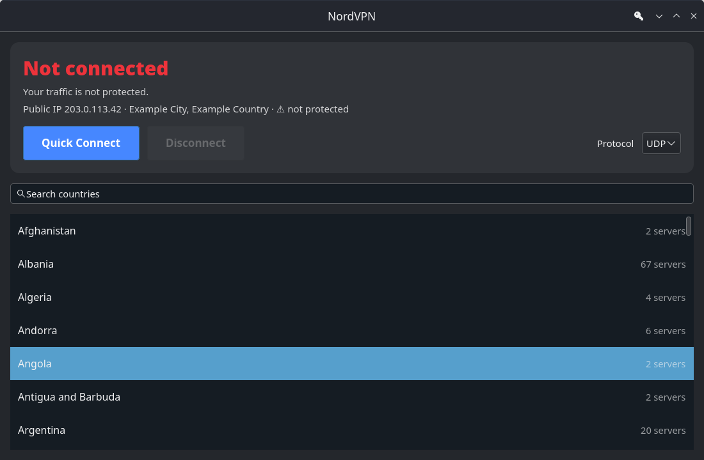

# NordVPN GUI for SteamOS

A small GTK4 app for connecting a Steam Deck (or any Linux machine running NetworkManager) to NordVPN. It runs in Desktop Mode and in Game Mode.

It uses only what SteamOS already ships: Python 3, GTK4, `nmcli`, and NetworkManager's OpenVPN plugin. You don't install packages and you don't unlock the read-only filesystem, so the app lives in your home folder and survives SteamOS updates.



## Features

- **Quick Connect** to the server NordVPN currently recommends.
- **Country list** with search (by name or two-letter code, e.g. `de`, `jp`).
- **UDP or TCP** protocol. TCP often gets through networks that block VPNs.
- **Live status** with your public IP, location, and whether NordVPN sees you as protected.
- **Clear error messages** for wrong credentials, blocked networks, and DNS failures.
- Detects VPNs started elsewhere (Plasma network applet, TunnelDeck) and replaces them so two tunnels never fight over routes.
- Large, controller-friendly buttons and rows.

## Requirements

| Requirement | Notes |
|---|---|
| SteamOS 3.x, or another Linux desktop with NetworkManager | Tested target is the Steam Deck |
| Python 3 with PyGObject and GTK 4 | Included in SteamOS |
| `NetworkManager-openvpn` plugin | Included in SteamOS |
| An active NordVPN subscription | You need its **service credentials** (see below) |

To check that the OpenVPN plugin is present:

```bash
ls /usr/lib/NetworkManager/VPN/ | grep -i openvpn
```

If nothing is printed (likely only on non-SteamOS distros), install your distro's `networkmanager-openvpn` / `NetworkManager-openvpn` package.

## Step 1: Get your NordVPN service credentials

The app does **not** use your NordVPN email and account password. It needs the separate *service credentials* that NordVPN issues for manual (OpenVPN) setups.

1. Sign in at <https://my.nordaccount.com>.
2. Go to **NordVPN → Manual setup** (you may need to confirm by email).
3. Under **Service credentials**, copy the **username** and **password**.

Keep them handy for Step 4.

## Step 2: Download the app

Switch to **Desktop Mode** (Steam button → Power → Switch to Desktop), open **Konsole**, and put the project somewhere in your home folder:

```bash
mkdir -p ~/Applications
cd ~/Applications
git clone https://github.com/Hmmnd0/nordvpn-gui-steamos.git nordvpn-gui
cd nordvpn-gui
```

Or copy the folder over with a USB stick or file share. It only needs `nordvpn_gui.py` and `install.sh`.

> **Don't move the folder after installing.** The menu shortcut points to the folder's absolute path. If you move it, run `install.sh` again from the new location.

## Step 3: Install the menu shortcut

```bash
./install.sh
```

This:

- makes `nordvpn_gui.py` executable, and
- creates `~/.local/share/applications/nordvpn-gui.desktop`, so **NordVPN** appears in the application launcher under *Internet/Network*.

It doesn't need `sudo` and doesn't touch anything outside your home folder.

To run the app without installing the shortcut:

```bash
python3 nordvpn_gui.py
```

## Step 4: First run

1. Open **NordVPN** from the app launcher.
2. Click **Quick Connect** or pick a country.
3. The first time, a credentials window opens. Paste your **service username and password** from Step 1 and press **Save**.
4. The status card turns yellow (*Connecting…*), then green (*Connected*). The line under it shows your new public IP and location, marked **🔒 protected**.

To change your credentials later, click the **key icon** in the top-right of the window.

## Step 5 (optional): Use it from Game Mode

1. In Desktop Mode, open **Steam**.
2. Go to **Games → Add a Non-Steam Game to My Library…**.
3. Tick **NordVPN** in the list and click **Add Selected Programs**.
4. Switch back to Game Mode. NordVPN is in your Library under **Non-Steam**.

Launch it, connect, then press the **Steam button** to go back to your game or the Library. **The VPN stays connected after you close the app**, because the tunnel is managed by NetworkManager rather than the app.

Tip: if you need to type credentials in Game Mode, press **Steam + X** to bring up the on-screen keyboard. It's easier to enter them once in Desktop Mode.

## Using the app

| Action | How |
|---|---|
| Connect to the best server | **Quick Connect** |
| Connect to a country | Click or press A on a country row |
| Find a country | Type in **Search countries** (name or ISO code) |
| Disconnect | **Disconnect** (also drops VPNs started by other apps) |
| Switch protocol | **Protocol** dropdown → UDP / TCP. Applies to the next connection |
| Change credentials | Key icon in the header bar |

Connecting while already connected switches servers: the current tunnel is brought down first.

The status colors are:

- 🟢 **Connected**: shows the server name, city, and country. If the tunnel was set up outside this app, it says so.
- 🟡 **Connecting… / Disconnecting…**
- 🔴 **Not connected**: your traffic is not going through the VPN.

## Where things are stored

| Path | Contents |
|---|---|
| `~/.config/nordvpn-gui/config.json` | Service username, service password, chosen protocol, last server. File mode `0600` (only your user can read it) |
| `~/.cache/nordvpn-gui/` | Short-lived files: the downloaded `.ovpn` config and the password file for `nmcli`. Both are deleted right after use |
| `~/.cert/nm-openvpn/` | Certificates NetworkManager extracts on import. Removed when the app replaces its connection |
| NetworkManager | One VPN connection named `NordVPN GUI <server>`. Autoconnect is off and the password is **not** saved in it |

Security notes:

- The service password is stored **in plain text** in `config.json`, protected only by file permissions. These are service credentials, not your account login, and you can regenerate them at any time from Nord Account.
- The password is never stored in NetworkManager, so no keyring or secret agent is needed. That's what makes it work in Game Mode.

## How it works

1. Asks the NordVPN API (`api.nordvpn.com/v1/servers/recommendations`) for the least-loaded OpenVPN server, filtered by country and protocol.
2. Downloads that server's official `.ovpn` file from `downloads.nordcdn.com`.
3. Imports it with `nmcli connection import type openvpn`, deleting the app's previous connection first.
4. Brings it up with `nmcli connection up … passwd-file …`, passing the password through a temporary `0600` file.
5. Watches the OpenVPN log (`journalctl -t nm-openvpn`) so a rejected password fails in a second or two instead of after NetworkManager's 60-second timeout.
6. Polls `nmcli` every 2 seconds for status, and `api.nordvpn.com/v1/helpers/ips/insights` for your public IP when the state changes.

## Troubleshooting

**"NordVPN rejected the username/password."**
You're probably using your email and account password. Use the **service credentials** from Step 1. If they were recently regenerated, update them with the key icon.

**"The server never answered…"**
The network (school, work, hotel, some public Wi-Fi) is blocking OpenVPN over UDP. Switch **Protocol** to **TCP** and connect again.

**"Couldn't reach the NordVPN API"** / the country list is empty
There's no internet connection, or `api.nordvpn.com` is blocked. Check your Wi-Fi, then restart the app.

**"Couldn't look up the server's address."**
DNS isn't working. Check your internet connection, or try another network.

**The app doesn't appear in the launcher**
Run `./install.sh` again, then log out and back in. Check that `~/.local/share/applications/nordvpn-gui.desktop` exists.

**It stopped launching after I moved the folder**
Run `./install.sh` from the new location. If you added it to Steam, remove the old Non-Steam entry and add it again.

**I want to see the raw logs**

```bash
journalctl -b -t nm-openvpn --no-pager | tail -50
nmcli connection show | grep -i nordvpn
```

**Disconnect from the terminal**

```bash
nmcli connection down "$(nmcli -g NAME,TYPE connection show --active | awk -F: '$2=="vpn"{print $1; exit}')"
```

## Uninstall

```bash
# Remove the VPN connection(s) the app created
nmcli -g UUID,NAME connection show | awk -F: '$2 ~ /^NordVPN GUI/ {print $1}' | xargs -r -n1 nmcli connection delete

# Remove the launcher entry, settings, and cache
rm -f ~/.local/share/applications/nordvpn-gui.desktop
rm -rf ~/.config/nordvpn-gui ~/.cache/nordvpn-gui
update-desktop-database ~/.local/share/applications 2>/dev/null || true

# Finally, delete the project folder
rm -rf ~/Applications/nordvpn-gui
```

If you added it to Steam, right-click the Non-Steam entry → **Manage → Remove non-Steam game from your library**.

## Disclaimer

This is an unofficial, community-made tool. It isn't affiliated with or endorsed by NordVPN or Valve. It uses NordVPN's public server API and standard OpenVPN configs.

## License

MIT. See [LICENSE](LICENSE).
